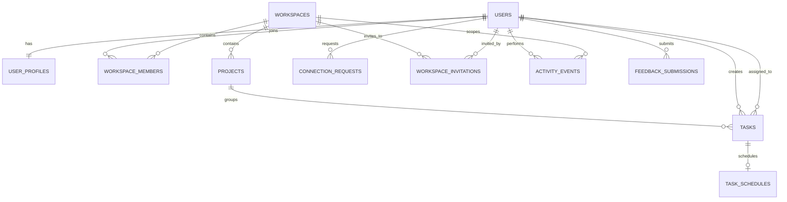

# Orbit Workspace Backend Handoff

This document describes Orbit Workspace, its core data model, and the backend behaviors the application depends on. See [API_ENDPOINTS.md](./API_ENDPOINTS.md) for route paths, request/response JSON, and frontend call timing.

## Current Frontend Boundary

The app has no backend implementation in this repository. When `NEXT_PUBLIC_API_URL` is not configured, Zustand uses seeded mock data; project and task changes persist in browser storage. When the URL is configured, authentication, account bootstrap, workspace, project, task, and connection screens call the backend for supported reads and writes. Invitations, notification state, activity, and calendar scheduling still use local demo state.

The frontend currently supports:

- Workspace create, edit, switch, and delete.
- Project create, edit, delete, and project-scoped task lists.
- Task create, edit, complete/reopen, delete, and calendar scheduling with an optional time.
- Profile name, email, role/title, pronouns, bio, availability, and status message.
- Workspace invitation records, connection requests by public Orbit ID, profile activity, and feedback records.
- Workspace preferences for notifications, timezone, week start, and active workspace.

Invitation records do not send email, feedback does not reach a support team, and profile editing/preferences are not yet server-backed. The hard-coded people directory and starter records remain for mock mode and should be replaced by authenticated backend data.

## Public Pages and Theme

- The landing page at `/` has Product, How it works, About, and Pricing sections. Its section links use smooth scrolling and respect reduced-motion preferences.
- `/about` explains the product's purpose and guiding principles. Login and registration are available at `/login` and `/register`.
- A shared theme provider applies the light/dark choice across the public pages and workspace. It follows the operating-system preference on load; a manual choice applies for the current page session.
- Login, registration, and password reset call the configured backend. The workspace Logout link currently navigates to `/`; it does not yet end the server session.

## Entity Relationships

## Tables

Use UUID primary keys for internal relations. The public Orbit ID is a separate, human-shareable identifier. Use UTC timestamps (`TIMESTAMPTZ`) and store user timezone preferences separately.

### `users`

Authentication identity and globally unique public lookup ID.

| Column         | Type                                        | Notes                                                                      |
| -------------- | ------------------------------------------- | -------------------------------------------------------------------------- |
| `id`           | UUID, PK                                    | Internal user identifier.                                                  |
| `auth_subject` | TEXT, UNIQUE, NOT NULL                      | Stable subject from the chosen auth provider; do not store passwords here. |
| `public_id`    | TEXT, UNIQUE, NOT NULL                      | Shareable ID such as `ORB-1042`; indexed for exact directory lookup.       |
| `email`        | CITEXT or normalized TEXT, UNIQUE, NOT NULL | Verified account email.                                                    |
| `created_at`   | TIMESTAMPTZ                                 | Defaults to `now()`.                                                       |
| `updated_at`   | TIMESTAMPTZ                                 | Updated on account changes.                                                |
| `deleted_at`   | TIMESTAMPTZ, nullable                       | Optional soft-delete marker.                                               |

### `user_profiles`

User-editable details shown on Profile and in the account menu. `user_id` is both PK and FK to `users.id`.

| Column           | Type           | Notes                                                           |
| ---------------- | -------------- | --------------------------------------------------------------- |
| `user_id`        | UUID, PK/FK    | One-to-one with `users`.                                        |
| `display_name`   | TEXT, NOT NULL | Frontend `name`.                                                |
| `role_title`     | TEXT, nullable | Personal job title; distinct from a workspace permission role.  |
| `pronouns`       | TEXT, nullable | User-entered display detail.                                    |
| `bio`            | TEXT, nullable | Enforce a reasonable length limit, e.g. 500 characters.         |
| `avatar_url`     | TEXT, nullable | Object-storage URL; the current frontend only derives initials. |
| `availability`   | TEXT, NOT NULL | Check constraint: `available`, `away`, `do_not_disturb`.        |
| `status_message` | TEXT, nullable | Short team-visible status.                                      |
| `updated_at`     | TIMESTAMPTZ    | Updated on profile edits.                                       |

### `workspaces`

| Column          | Type                  | Notes                                               |
| --------------- | --------------------- | --------------------------------------------------- |
| `id`            | UUID, PK              | Workspace ID.                                       |
| `name`          | TEXT, NOT NULL        | Workspace display name.                             |
| `description`   | TEXT, nullable        | Workspace purpose.                                  |
| `owner_user_id` | UUID, FK → `users.id` | Initial owner.                                      |
| `created_at`    | TIMESTAMPTZ           |                                                     |
| `updated_at`    | TIMESTAMPTZ           |                                                     |
| `archived_at`   | TIMESTAMPTZ, nullable | Prefer archive over cascading destructive deletion. |

### `workspace_members`

Join table and authorization boundary. Composite PK: (`workspace_id`, `user_id`).

| Column         | Type                       | Notes                                                                                          |
| -------------- | -------------------------- | ---------------------------------------------------------------------------------------------- |
| `workspace_id` | UUID, FK → `workspaces.id` |                                                                                                |
| `user_id`      | UUID, FK → `users.id`      |                                                                                                |
| `role`         | TEXT, NOT NULL             | Check constraint: `owner`, `admin`, `member`, `guest`. This is not `user_profiles.role_title`. |
| `joined_at`    | TIMESTAMPTZ                |                                                                                                |
| `created_at`   | TIMESTAMPTZ                |                                                                                                |

### `user_preferences`

One row per user; PK/FK `user_id` → `users.id`. The current settings screen treats these as user defaults.

| Column                | Type                                | Notes                                                                 |
| --------------------- | ----------------------------------- | --------------------------------------------------------------------- |
| `user_id`             | UUID, PK/FK                         |                                                                       |
| `active_workspace_id` | UUID, nullable FK → `workspaces.id` | Validate that the user is a member of this workspace.                 |
| `email_notifications` | BOOLEAN                             |                                                                       |
| `task_updates`        | BOOLEAN                             |                                                                       |
| `mentions`            | BOOLEAN                             |                                                                       |
| `weekly_digest`       | BOOLEAN                             |                                                                       |
| `timezone`            | TEXT, NOT NULL                      | IANA zone, e.g. `America/Los_Angeles`.                                |
| `week_starts_on`      | SMALLINT or TEXT                    | `1`/`monday` or `0`/`sunday`; choose one representation consistently. |
| `theme`               | TEXT                                | Optional; currently stored separately in browser storage.             |
| `updated_at`          | TIMESTAMPTZ                         |                                                                       |

If notification choices are workspace-specific, move them to a `workspace_preferences` table keyed by `workspace_id` instead of silently treating them as global user choices.

### `projects`

| Column             | Type                                 | Notes                                                                                 |
| ------------------ | ------------------------------------ | ------------------------------------------------------------------------------------- |
| `id`               | UUID, PK                             | Stable ID used by task foreign keys and project routes.                               |
| `workspace_id`     | UUID, FK → `workspaces.id`, NOT NULL | A project belongs to one workspace.                                                   |
| `name`             | TEXT, NOT NULL                       | Unique within a workspace; index (`workspace_id`, normalized `name`).                 |
| `description`      | TEXT, nullable                       |                                                                                       |
| `color`            | TEXT, NOT NULL                       | Store a semantic color token, not a Tailwind class string.                            |
| `due_at`           | DATE, nullable                       |                                                                                       |
| `progress_percent` | SMALLINT, nullable                   | Prefer deriving progress from completed tasks; if manually editable, constrain 0–100. |
| `created_by`       | UUID, FK → `users.id`                |                                                                                       |
| `created_at`       | TIMESTAMPTZ                          |                                                                                       |
| `updated_at`       | TIMESTAMPTZ                          |                                                                                       |
| `archived_at`      | TIMESTAMPTZ, nullable                |                                                                                       |

### `project_members` (optional, recommended for per-project access)

The frontend's starter projects have member initials, but these are not stable user identities. Replace them with this join table if projects can have a subset of workspace members.

| Column       | Type                     | Notes                                    |
| ------------ | ------------------------ | ---------------------------------------- |
| `project_id` | UUID, FK → `projects.id` |                                          |
| `user_id`    | UUID, FK → `users.id`    |                                          |
| `role`       | TEXT, nullable           | Optional project-level role.             |
| `added_at`   | TIMESTAMPTZ              | Composite PK: (`project_id`, `user_id`). |

### `tasks`

| Column         | Type                               | Notes                                                                                             |
| -------------- | ---------------------------------- | ------------------------------------------------------------------------------------------------- |
| `id`           | UUID, PK                           | Stable task ID.                                                                                   |
| `project_id`   | UUID, FK → `projects.id`, NOT NULL | Do not relate tasks by project name.                                                              |
| `title`        | TEXT, NOT NULL                     |                                                                                                   |
| `description`  | TEXT, nullable                     | Useful extension; not currently in the form.                                                      |
| `priority`     | TEXT, NOT NULL                     | Check constraint: `low`, `medium`, `high`.                                                        |
| `status`       | TEXT, NOT NULL                     | Current UI values: Todo, In progress, In review. Add `done` as the canonical completed state.     |
| `due_at`       | DATE, nullable                     | Current seed data also contains labels such as `Today`; normalize these during migration.         |
| `created_by`   | UUID, FK → `users.id`              |                                                                                                   |
| `assignee_id`  | UUID, nullable FK → `users.id`     | Recommended next task workflow; current demo tasks are implicitly assigned to the signed-in user. |
| `completed_at` | TIMESTAMPTZ, nullable              | Set/clear as status changes.                                                                      |
| `position`     | NUMERIC or sortable key            | Optional stable order within a project.                                                           |
| `created_at`   | TIMESTAMPTZ                        |                                                                                                   |
| `updated_at`   | TIMESTAMPTZ                        |                                                                                                   |
| `deleted_at`   | TIMESTAMPTZ, nullable              | Optional soft-delete marker.                                                                      |

The current client stores both `status` and `completed: boolean`. Prefer `status = 'done'` plus `completed_at` in the database, then derive the legacy boolean in API responses until the frontend is migrated.

### `task_schedules`

Calendar scheduling is distinct from a task's deadline. The current calendar allows one scheduled date/time per task, so `task_id` can be unique. Remove that uniqueness if tasks later support multiple sessions.

| Column           | Type                         | Notes                                                                            |
| ---------------- | ---------------------------- | -------------------------------------------------------------------------------- |
| `id`             | UUID, PK                     |                                                                                  |
| `task_id`        | UUID, UNIQUE/FK → `tasks.id` | One schedule entry per task in the current UI.                                   |
| `scheduled_date` | DATE, NOT NULL               | Calendar day.                                                                    |
| `scheduled_time` | TIME, nullable               | Optional local start time.                                                       |
| `timezone`       | TEXT, NOT NULL               | Snapshot of the scheduling timezone, or resolve from user preferences by policy. |
| `created_by`     | UUID, FK → `users.id`        |                                                                                  |
| `created_at`     | TIMESTAMPTZ                  |                                                                                  |
| `updated_at`     | TIMESTAMPTZ                  |                                                                                  |

### `connection_requests`

Keep connection requests separate from workspace invitations. A connection links two user accounts; a workspace invitation grants membership in one workspace.

| Column              | Type                            | Notes                                           |
| ------------------- | ------------------------------- | ----------------------------------------------- |
| `id`                | UUID, PK                        |                                                 |
| `requester_user_id` | UUID, FK → `users.id`, NOT NULL | Authenticated sender.                           |
| `recipient_user_id` | UUID, FK → `users.id`, NOT NULL | Resolved from the recipient's `public_id`.      |
| `status`            | TEXT, NOT NULL                  | `pending`, `accepted`, `declined`, `cancelled`. |
| `created_at`        | TIMESTAMPTZ                     |                                                 |
| `responded_at`      | TIMESTAMPTZ, nullable           |                                                 |
| `updated_at`        | TIMESTAMPTZ                     |                                                 |

Add a check preventing a user from connecting to themselves. Prevent duplicate pending requests for the same unordered user pair; enforce this transactionally so simultaneous requests cannot race.

### `workspace_invitations`

| Column                | Type                                 | Notes                                                             |
| --------------------- | ------------------------------------ | ----------------------------------------------------------------- |
| `id`                  | UUID, PK                             |                                                                   |
| `workspace_id`        | UUID, FK → `workspaces.id`, NOT NULL |                                                                   |
| `email`               | CITEXT or normalized TEXT, NOT NULL  | Invite destination.                                               |
| `role`                | TEXT, NOT NULL                       | `admin`, `member`, or `guest`; validate against workspace policy. |
| `invited_by_user_id`  | UUID, FK → `users.id`, NOT NULL      | Must have permission to invite.                                   |
| `status`              | TEXT, NOT NULL                       | `pending`, `accepted`, `revoked`, `expired`.                      |
| `token_hash`          | TEXT, nullable                       | Store a hash, never a raw invitation token.                       |
| `expires_at`          | TIMESTAMPTZ, nullable                |                                                                   |
| `accepted_by_user_id` | UUID, nullable FK → `users.id`       |                                                                   |
| `created_at`          | TIMESTAMPTZ                          |                                                                   |
| `updated_at`          | TIMESTAMPTZ                          |                                                                   |

Enforce at most one pending invitation per (`workspace_id`, normalized `email`). Sending an invitation should dispatch email only after the record is committed, ideally through an outbox/job.

### `activity_events`

Append-only audit/activity timeline. The frontend currently renders a short action and target label and keeps at most 100 events locally.

| Column          | Type                                | Notes                                                                                     |
| --------------- | ----------------------------------- | ----------------------------------------------------------------------------------------- |
| `id`            | UUID, PK                            |                                                                                           |
| `workspace_id`  | UUID, nullable FK → `workspaces.id` | Null for account-wide activity.                                                           |
| `actor_user_id` | UUID, nullable FK → `users.id`      | Null for system actions.                                                                  |
| `action`        | TEXT, NOT NULL                      | E.g. `task.completed`, `project.created`, `profile.updated`. Prefer stable machine codes. |
| `entity_type`   | TEXT, nullable                      | `task`, `project`, `workspace`, `profile`, `invitation`, etc.                             |
| `entity_id`     | UUID, nullable                      |                                                                                           |
| `summary`       | TEXT, NOT NULL                      | Human-readable target/context.                                                            |
| `metadata`      | JSONB                               | Small non-sensitive details for richer rendering.                                         |
| `created_at`    | TIMESTAMPTZ                         | Index (`actor_user_id`, `created_at DESC`) and (`workspace_id`, `created_at DESC`).       |

Do not put secrets, invitation tokens, or unnecessary personal data in activity metadata.

### `feedback_submissions`

| Column        | Type                                | Notes                                                                  |
| ------------- | ----------------------------------- | ---------------------------------------------------------------------- |
| `id`          | UUID, PK                            |                                                                        |
| `user_id`     | UUID, nullable FK → `users.id`      | Nullable for unauthenticated feedback.                                 |
| `reply_email` | CITEXT or normalized TEXT, nullable |                                                                        |
| `topic`       | TEXT, NOT NULL                      | Current choices: feature request, bug report, account question, other. |
| `message`     | TEXT, NOT NULL                      | Validate length and sanitize on output.                                |
| `status`      | TEXT, NOT NULL                      | `new`, `in_review`, `answered`, `closed`.                              |
| `created_at`  | TIMESTAMPTZ                         |                                                                        |
| `updated_at`  | TIMESTAMPTZ                         |                                                                        |

## Backend Behaviors

All protected operations must derive the actor from the authenticated session, never a client-supplied user ID. Check workspace membership and project permissions for every read and write. Treat browser-cached state as a display cache, not an authorization source.

Create and update records transactionally with their relationship rows and audit events. Prefer archiving workspaces and projects or require explicit confirmation before cascading deletion. Validate status, priority, dates, and relation ownership at the API boundary; return structured errors with actionable codes and messages.

For route paths, request and response JSON, frontend call timing, and features that still need backend integration, see [API_ENDPOINTS.md](./API_ENDPOINTS.md).

## End-to-End Flows

- Authenticate using a secure server-side session, then load the signed-in profile, preferences, and workspace memberships.
- Select the saved active workspace only if membership is still valid, then load that workspace's projects and tasks.
- Create or update projects and tasks transactionally. Keep task relationships based on stable project IDs rather than display names.
- Complete tasks by setting canonical status to `done` and recording `completed_at`; keep calendar scheduling separate from a task deadline.
- Create workspace invitations only after checking inviter permissions; create membership after the invitee accepts.
- Keep user-to-user connections distinct from workspace membership. Prevent self-requests and duplicate or reverse pending requests.
- Write activity events for important actions without recording secrets or unnecessary personal information.

## Frontend-to-Backend Mapping Notes

- `WorkspaceProject.workspace_id` → `projects.workspace_id`.
- `Task.projectId` → `tasks.project_id`; `Task.project` is display text and should not be treated as a key.
- `Task.completed` should be derived from canonical task status and `completed_at`.
- Task and project dates use database `DATE` or `TIMESTAMPTZ` values; do not persist presentation labels as dates.
- Current project member initials are demo display values. Resolve real members to user IDs before writing `project_members`.
- Current profile invitations store only email, role, status, and time. Production invitations need workspace scope, inviter, secure token lifecycle, expiry, and mail delivery.
- Current connection rows duplicate recipient name/email for demo display. Production requests should reference user IDs; names/emails come from the authorized user lookup.
- Calendar schedule state currently uses one date and optional time per task in browser storage. If multi-session planning is required, model schedules as multiple task events instead of enforcing a unique `task_id`.

## Suggested Implementation Order

1. Authentication/session and `users`/`user_profiles`.
2. Workspaces, memberships, authorization checks, and preferences.
3. Projects, tasks, and transaction-safe activity events.
4. Task schedules and calendar persistence.
5. Connection requests by public Orbit ID.
6. Workspace invitations with email delivery and acceptance.
7. Feedback intake/support routing, then replace remaining local demo stores with API loading/mutations and loading/error states.
